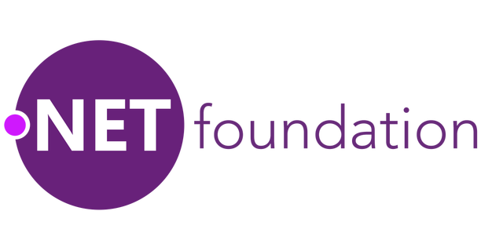

<h1 align="center">
  <br>
  
  <br>
  PeachPie Compiler
  <br>
</h1>

<h3 align="center">The open-source PHP compiler to .NET</h3>

<p align="center">
  <a href="https://github.com/peachpiecompiler/peachpie/actions/workflows/dotnet.yml"></a>
  <a href="https://www.nuget.org/packages/Peachpie.NET.Sdk/"></a>
  <a href="https://discord.com/invite/SAs8VP2XqP"></a>
  <a href="https://docs.peachpie.io"></a>
  <a href="https://www.peachpie.io"></a>
  <a href="https://x.com/pchpcompiler"></a>
  <a href="https://www.patreon.com/pchpcompiler"></a>
  <a href="LICENSE.txt"></a>
</p>

PeachPie compiles PHP into .NET assemblies and runs them on the .NET runtime. It is a member project of the [.NET Foundation](https://dotnetfoundation.org/).

The badge above tracks the latest stable [`Peachpie.NET.Sdk`](https://www.nuget.org/packages/Peachpie.NET.Sdk/) on NuGet. Release notes are on the [GitHub releases page](https://github.com/peachpiecompiler/peachpie/releases). Continuous integration for this repository is [GitHub Actions](https://github.com/peachpiecompiler/peachpie/actions/workflows/dotnet.yml) (`.github/workflows/dotnet.yml`).

## Quick start

The first build downloads the current packages, so allow a minute.

### Prerequisites

- A [.NET SDK](https://dotnet.microsoft.com/download).
- The .NET runtime for the framework that [`Peachpie.NET.Sdk`](https://www.nuget.org/packages/Peachpie.NET.Sdk/) targets. The NuGet page lists that framework under the package dependencies. The compiler ships as an application for that framework, so install the matching runtime beside the SDK. A newer SDK on its own stops with a missing-framework error.

### Project template

Install [`Peachpie.Templates`](https://www.nuget.org/packages/Peachpie.Templates) without a version so `dotnet` takes the latest stable package:

```shell
dotnet new install Peachpie.Templates
mkdir HelloTpl && cd HelloTpl
dotnet new console -lang PHP
dotnet run
```

The build prints a compiler banner with the version it restored, then the program prints:

```text
HelloTpl says: "Hello World!"
```

The generated script does not call `exit(0)`, so the process exit code is 1. If the template's target framework is out of support, the SDK reports `NETSDK1138` and the build still finishes once the matching runtime is installed.

The same install also adds the `web`, `classlib`, `blazorwasm`, and `phpwasm` templates. The web layout is described in [Get started](https://docs.peachpie.io/get-started/). When that page and the NuGet page disagree about the .NET requirement, follow NuGet.

A sample project file is in the documentation: [Sample project file](https://docs.peachpie.io/php/msbuild/#sample-project-file).

## What is PeachPie?

PeachPie is a modern PHP compiler based on the Microsoft Roslyn compiler platform. It allows PHP to be compiled and executed under the .NET runtime, thereby opening the door for PHP developers into the world of .NET – and vice versa.

## Project goals

- **Both-way interoperability**: the project allows for hybrid applications, where parts are written in C# and others in PHP. The parts will be entirely compatible and can communicate seamlessly, all within the .NET framework.

- **Full .NET compatibility**: compiled programs run on the reimplemented PeachPie runtime, fully compatible with the PHP runtime.

- **Security**: since programs run within the standardized and manageable .NET or .NET Core environment, the code is fully verifiable without any unsafe constructs. In addition, PHP applications can be distributed source-lessly for added security benefits.

- **Cross-platform development**: the project compiles legacy PHP code into portable class libraries, enabling developers to build cross-platform apps and libraries for Microsoft platforms.

- **Increased performance**: PeachPie's extensive type analysis and the influence of Microsoft Roslyn should provide improved performance of PHP applications and components.

## PHP versions and frameworks

### Language level

The project property `LangVersion` selects PHP syntax and semantics. Accepted values, the default, and `latest` are documented in the [project file reference](https://docs.peachpie.io/php/msbuild/). Function and extension coverage is tracked on the [compatibility overview](https://docs.peachpie.io/php/compatibility/) and the [function-level status](https://docs.peachpie.io/compatibility-status/). Those pages can lag a release. Milestones are listed on the [roadmap](https://docs.peachpie.io/roadmap/).

### ASP.NET Core

This repository publishes [`Peachpie.AspNetCore.Web`](https://www.nuget.org/packages/Peachpie.AspNetCore.Web/) and [`Peachpie.AspNetCore.Mvc`](https://www.nuget.org/packages/Peachpie.AspNetCore.Mvc/), versioned with the compiler. `Peachpie.AspNetCore.Web` hosts compiled PHP in the ASP.NET Core pipeline. The `web` template (`dotnet new web -lang PHP`) references that package. Target frameworks are on the NuGet pages.

### WordPress

WordPress on .NET is the separate NuGet package [`PeachPied.WordPress.AspNetCore`](https://www.nuget.org/packages/PeachPied.WordPress.AspNetCore/), maintained outside this repository. That page lists the PeachPie packages it depends on. Setup steps are on [WpDotNet](https://www.wpdotnet.com/getting-started/) and in [iolevel/wpdotnet-sdk](https://github.com/iolevel/wpdotnet-sdk); the [docs overview](https://docs.peachpie.io/scenarios/wordpress/overview/) can lag the package, so prefer NuGet and WpDotNet when they disagree. Plugins and themes are compiled into the application.

Laravel and other full frameworks are not documented targets of this repository. An older MediaWiki sample lives at [iolevel/peachpie-mediawiki](https://github.com/iolevel/peachpie-mediawiki). The project's [2023 write-up](https://www.peachpie.io/blog/2023/05/14/what-you-can-build-with-peachpie/) says that sample had not been tested in a while.

## IDEs

The [PeachPie Visual Studio extension](https://marketplace.visualstudio.com/items?itemName=iolevel.peachpie-vs) adds PHP (PeachPie) project templates. It is published separately from the compiler packages. The command-line steps above follow the current NuGet release.

Visual Studio Code and Rider build and debug a PeachPie project as a normal .NET project. Project properties are in the [project file reference](https://docs.peachpie.io/php/msbuild/).

## Releases and support

Public releases are on [NuGet](https://www.nuget.org/packages/Peachpie.NET.Sdk/) and the [GitHub releases page](https://github.com/peachpiecompiler/peachpie/releases). The badge at the top of this file shows the latest stable SDK version.

Patreon subscribers also get nightly and preview builds from the [PeachPie NuGet feed](https://feed.peachpie.io/). [Become a Patron](https://www.patreon.com/pchpcompiler) to get that feed and to be listed as a sponsor. PeachPie is maintained in our spare time.

## Documentation, samples, and feedback

- Documentation: [docs.peachpie.io](https://docs.peachpie.io)
- Samples: [iolevel/peachpie-samples](https://github.com/iolevel/peachpie-samples). Some samples expect the Patreon NuGet feed described above.
- Questions and bugs: [Discord](https://discord.com/invite/SAs8VP2XqP) or a [GitHub issue](https://github.com/peachpiecompiler/peachpie/issues). We try to respond as quickly as possible.
- News: [@pchpcompiler](https://x.com/pchpcompiler) and [peachpie.io](https://www.peachpie.io)

## Build from source

Building this repository is described in [Building PeachPie](docs/Building-Peachpie.md). That guide is where the SDK requirement and the local package version live.

## Contributing

If you can help, pull requests and issues are welcome. Please read the [contribution guidelines](CONTRIBUTING.md) first, and follow the [code of conduct](CODE_OF_CONDUCT.md) when you post or talk to other people.

## License

PeachPie is licensed under the [Apache License 2.0](LICENSE.txt).

## .NET Foundation

<a href="https://dotnetfoundation.org"></a>

This project is supported by the [.NET Foundation](https://dotnetfoundation.org/).
