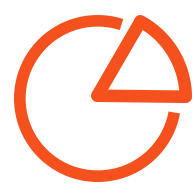
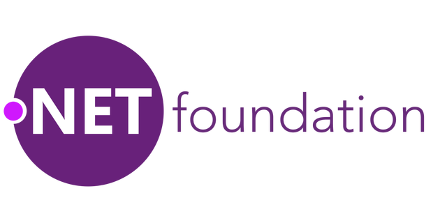

<h1 align="center">
  <br>
  
  <br>
  PeachPie Compiler
  <br>
</h1>

<h3 align="center">The open-source PHP compiler to .NET</h3>

<p align="center">
  <a href="https://github.com/peachpiecompiler/peachpie/actions/workflows/dotnet.yml"></a>
  <a href="https://www.nuget.org/packages/Peachpie.NET.Sdk/"></a>
  <a href="https://discord.com/invite/SAs8VP2XqP"></a>
  <a href="https://docs.peachpie.io"></a>
  <a href="https://www.peachpie.io"></a>
  <a href="https://x.com/pchpcompiler"></a>
  <a href="https://www.patreon.com/pchpcompiler"></a>
  <a href="LICENSE.txt"></a>
</p>

PeachPie compiles PHP into .NET assemblies and runs them on the .NET runtime. It is a member project of the [.NET Foundation](https://dotnetfoundation.org/).

The current public release is [v1.1.13](https://github.com/peachpiecompiler/peachpie/releases/tag/v1.1.13) ([`Peachpie.NET.Sdk` 1.1.13](https://www.nuget.org/packages/Peachpie.NET.Sdk/1.1.13) on NuGet). Continuous integration for this repository is [GitHub Actions](https://github.com/peachpiecompiler/peachpie/actions/workflows/dotnet.yml) (`.github/workflows/dotnet.yml` on `ubuntu-latest`, using the .NET 6 and .NET 9 SDKs).

## Quick start

These steps use the public 1.1.13 packages. The first build downloads them, so allow a minute.

### Prerequisites

- A [.NET SDK](https://dotnet.microsoft.com/download). The commands below were run with the .NET 8 SDK.
- The [.NET 6 runtime](https://dotnet.microsoft.com/download/dotnet/6.0). `Peachpie.NET.Sdk` 1.1.13 ships `Peachpie.CodeAnalysis` as a `net6.0` application whose runtime config asks for `Microsoft.NETCore.App` 6.0.0. It runs on a .NET 6 runtime. A machine with only the .NET 8 SDK stops on that compiler and reports the missing 6.0.0 framework.

### Project template

[`Peachpie.Templates` 1.0.33](https://www.nuget.org/packages/Peachpie.Templates/1.0.33) is the template package published with SDK 1.1.13.

```shell
dotnet new install Peachpie.Templates::1.0.33
mkdir HelloTpl && cd HelloTpl
dotnet new console -lang PHP
dotnet run
```

The build prints the compiler banner (`PeachPie PHP Compiler version 1.1.13`), then the program prints:

```text
HelloTpl says: "Hello World!"
```

The generated project targets `net6.0`. A newer SDK warns `NETSDK1138` because .NET 6 is out of support, and the build still finishes when the .NET 6 runtime is present. The generated `program.php` does not call `exit(0)`, so the process exit code is 1.

The same package also installs the `web`, `classlib`, `blazorwasm`, and `phpwasm` templates. See [Get started](https://docs.peachpie.io/get-started/) for the web layout. That page still lists ".NET SDK 5.0 or newer", which is older than these packages.

### Minimal project

The same compiler, written out by hand. Save both files in an empty directory. The project extension is `.msbuildproj`.

`hello.msbuildproj`:

```xml
<Project Sdk="Peachpie.NET.Sdk/1.1.13">
  <PropertyGroup>
    <OutputType>Exe</OutputType>
    <TargetFramework>net6.0</TargetFramework>
    <StartupObject>program.php</StartupObject>
  </PropertyGroup>
  <ItemGroup>
    <Compile Include="**/*.php" />
  </ItemGroup>
</Project>
```

`program.php`:

```php
<?php

echo "Hello from PeachPie\n";
exit(0);
```

```shell
dotnet run
```

The program prints `Hello from PeachPie` and exits 0. Expect the same `NETSDK1138` warning on an SDK newer than .NET 6.

The same two files also build and run with `<TargetFramework>net8.0</TargetFramework>` on the .NET 8 SDK, still with the .NET 6 runtime installed so the compiler can start. The official console template and the published PeachPie packages themselves target `net6.0`. More project properties are in the [project file reference](https://docs.peachpie.io/php/msbuild/).

## What is PeachPie?

PeachPie is a modern PHP compiler based on the Microsoft Roslyn compiler platform. It allows PHP to be compiled and executed under the .NET runtime, thereby opening the door for PHP developers into the world of .NET – and vice versa.

## Project goals

- **Both-way interoperability**: the project allows for hybrid applications, where parts are written in C# and others in PHP. The parts will be entirely compatible and can communicate seamlessly, all within the .NET framework.

- **Full .NET compatibility**: compiled programs run on the reimplemented PeachPie runtime, fully compatible with the PHP runtime.

- **Security**: since programs run within the standardized and manageable .NET or .NET Core environment, the code is fully verifiable without any unsafe constructs. In addition, PHP applications can be distributed source-lessly for added security benefits.

- **Cross-platform development**: the project compiles legacy PHP code into portable class libraries, enabling developers to build cross-platform apps and libraries for Microsoft platforms.

- **Increased performance**: PeachPie's extensive type analysis and the influence of Microsoft Roslyn should provide improved performance of PHP applications and components.

## PHP versions and frameworks

### Language level

`LangVersion` in this repository accepts `5.4`, `5.5`, `5.6`, `7.0` through `7.4`, and `8.0` through `8.5`. The default is `8.4`. `latest` selects `8.5`. Release 1.1.13 added language level 8.5, including the pipe operator (`|>`).

`LangVersion` selects syntax and semantics for that PHP level. Function and extension coverage is tracked on the [compatibility overview](https://docs.peachpie.io/php/compatibility/) and the [function-level status](https://docs.peachpie.io/compatibility-status/). The status page is labeled "PeachPie 1.0.6 vs. PHP 8.0.0", so it is older than release 1.1.13. The [roadmap](https://docs.peachpie.io/roadmap/) milestones stop around the 1.1 line.

### ASP.NET Core

This repository publishes [`Peachpie.AspNetCore.Web`](https://www.nuget.org/packages/Peachpie.AspNetCore.Web/) and [`Peachpie.AspNetCore.Mvc`](https://www.nuget.org/packages/Peachpie.AspNetCore.Mvc/). Version 1.1.13 of both packages targets `net6.0`. `Peachpie.AspNetCore.Web` hosts compiled PHP in the ASP.NET Core pipeline. The `web` template (`dotnet new web -lang PHP`) references that package.

### WordPress

WordPress on .NET is the separate NuGet package `PeachPied.WordPress.AspNetCore`, maintained outside this repository. The latest stable package at the time of writing is [6.7.1](https://www.nuget.org/packages/PeachPied.WordPress.AspNetCore/6.7.1) (February 2025). It targets `net6.0` and depends on PeachPie 1.1.11 (`Peachpie.AspNetCore.Web` / `Peachpie.AspNetCore.Mvc`). The [docs overview](https://docs.peachpie.io/scenarios/wordpress/overview/) still shows `6.3.1-rc-016` and a .NET Core 3.0 requirement. Current setup steps are on [WpDotNet](https://www.wpdotnet.com/getting-started/) and in [iolevel/wpdotnet-sdk](https://github.com/iolevel/wpdotnet-sdk). Plugins and themes are compiled into the application.

Laravel and other full frameworks are not documented targets of this repository. An older MediaWiki sample lives at [iolevel/peachpie-mediawiki](https://github.com/iolevel/peachpie-mediawiki). The project's [2023 write-up](https://www.peachpie.io/blog/2023/05/14/what-you-can-build-with-peachpie/) says that sample had not been tested in a while.

## IDEs

The [PeachPie Visual Studio extension](https://marketplace.visualstudio.com/items?itemName=iolevel.peachpie-vs) (version 1.0.11, last updated December 2021) adds PHP (PeachPie) project templates in Visual Studio. The command-line steps above use compiler 1.1.13.

Visual Studio Code and Rider build and debug a PeachPie project as a normal .NET project. The [project file reference](https://docs.peachpie.io/php/msbuild/) still recommends Visual Studio 15.6, which is older than the current SDK.

## Releases and support

Public releases, including 1.1.13, are on [NuGet](https://www.nuget.org/packages/Peachpie.NET.Sdk/) and the [GitHub releases page](https://github.com/peachpiecompiler/peachpie/releases).

Patreon subscribers also get nightly and preview builds from the [PeachPie NuGet feed](https://feed.peachpie.io/). [Become a Patron](https://www.patreon.com/pchpcompiler) to get that feed and to be listed as a sponsor. PeachPie is maintained in our spare time.

## Documentation, samples, and feedback

- Documentation: [docs.peachpie.io](https://docs.peachpie.io)
- Samples: [iolevel/peachpie-samples](https://github.com/iolevel/peachpie-samples). Some samples expect the Patreon NuGet feed described above.
- Questions and bugs: [Discord](https://discord.com/invite/SAs8VP2XqP) or a [GitHub issue](https://github.com/peachpiecompiler/peachpie/issues). We try to respond as quickly as possible.
- News: [@pchpcompiler](https://x.com/pchpcompiler) and [peachpie.io](https://www.peachpie.io)

## Build from source

Building this repository is described in [Building PeachPie](docs/Building-Peachpie.md). That guide asks for the .NET 9 SDK. Projects in the tree target `net6.0`, and a local build produces `1.2.0-dev` packages under `.nugs/`.

## Contributing

If you can help, pull requests and issues are welcome. Please read the [contribution guidelines](CONTRIBUTING.md) first, and follow the [code of conduct](CODE_OF_CONDUCT.md) when you post or talk to other people.

## License

PeachPie is licensed under the [Apache License 2.0](LICENSE.txt).

## .NET Foundation

<a href="https://dotnetfoundation.org"></a>

This project is supported by the [.NET Foundation](https://dotnetfoundation.org/).
